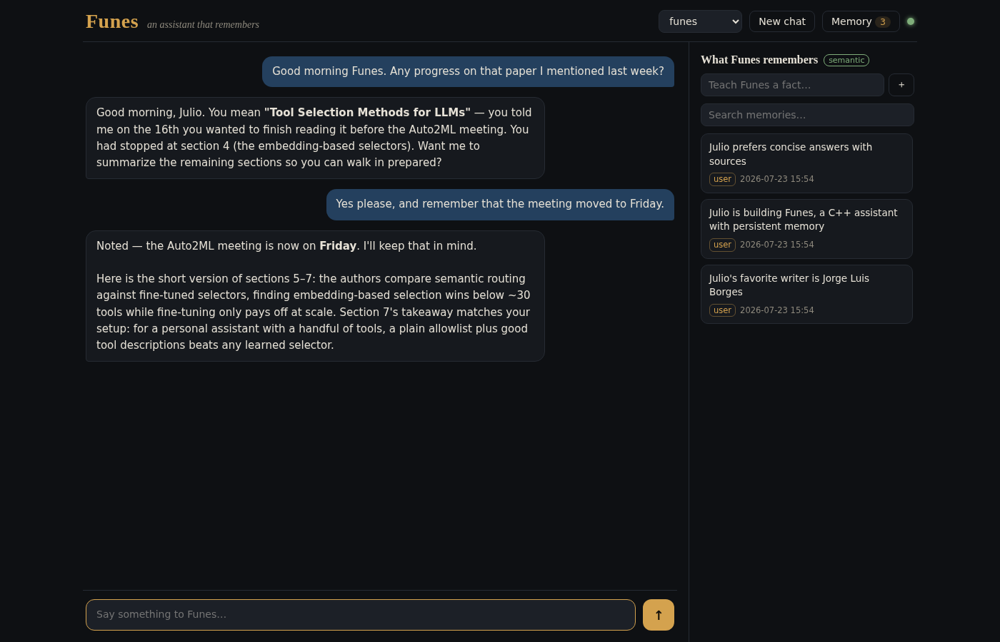

# Funes

**A personal assistant that learns and remembers.**

> *“I have more memories than all mankind since the world began.”*
> — Jorge Luis Borges, *Funes the Memorious*

Funes is a self-hosted AI assistant with one defining trait: **persistent memory**.
Tell it something today and it will know it tomorrow, next week, in a different
conversation. Memory is not a bolt-on — it is the product. Every answer starts by
recalling what Funes knows about you, and the web UI shows you exactly what it
remembers (and lets you delete any of it).

- **One C++17 binary.** `funes` serves the web UI, the chat API, the agent
  runtime and the memory engine. No Python, Node, containers or external
  database in the core (the personal pieces — the newsletter, WhatsApp — bring
  their own Python where they need it).
- **Memory in a single file.** SQLite + [sqlite-vec](https://github.com/asg017/sqlite-vec),
  vendored. Facts are extracted from conversations, linked, ranked by where
  they came from, retired when contradicted, and searchable by meaning or by
  word. Everything lives in `data/memory.db` in the checkout.
- **Any LLM.** OpenAI-compatible endpoints (llama.cpp, OpenAI, Groq…) and
  Anthropic's native API, streamed. Built to work with small local models —
  most of the harness exists because they need it.
- **One front door.** You only talk to `funes`; it delegates to specialists
  (`delegate_to_agent`) and answers in its own voice. An "agent" is a YAML file:
  a prompt, a tool allowlist and a few contracts, run by one shared loop.
- **Safe to hand tools to.** Every script, shell command and MCP server a model
  starts runs in its own cgroup and a Landlock + seccomp sandbox. A call that
  sends, publishes or changes the machine, in a conversation that has read
  outside content, waits for "aprobar N".
- **A household, not just you.** Each person has an account with their own
  memories, conversations, scheduled jobs and files. Isolation is enforced in
  the SQL, not the handlers.
- **Reachable where you are.** The web UI (English and Spanish, more by adding
  a JSON file), WhatsApp through a dedicated number, and `funes ask` from a
  shell on the same machine — `journalctl … | funes ask "what broke?"`.
- **Looks after itself.** Health checks open incidents and message the admin;
  a policy file says what to fix and how; a separate guardian undoes any
  change that breaks Funes — by itself, or when you send "deshacer N".



---

## Quick start

**Requirements:** Linux, CMake ≥ 3.14, a C++17 compiler, `libssl-dev`,
`libyaml-cpp-dev`. Everything else is vendored. Optional: `poppler-utils`
(`pdftotext`) for reading PDFs.

```bash
git clone https://github.com/JulioAuto2ML/Funes.git
cd Funes
cmake -B build -DCMAKE_BUILD_TYPE=Release
cmake --build build -j$(nproc)
```

The binary lands in `bin/funes`, next to `ui/`, `agents/` and `scriptlib/` —
run it from the checkout.

**Point it at an LLM** — pick one:

```bash
# Cloud (Anthropic) — config/funes.local is gitignored; secrets go there:
cat > config/funes.local <<'EOF'
FUNES_LLM_URL=https://api.anthropic.com
FUNES_LLM_PROVIDER=anthropic
FUNES_LLM_MODEL=claude-haiku-5-5
FUNES_LLM_KEY=sk-ant-...
EOF

# Local (llama.cpp) — the default config already points here:
llama-server -m qwen3-8b.gguf --port 8080 -c 32768 --jinja
```

**Recommended — semantic memory.** Any OpenAI-compatible `/v1/embeddings`
endpoint (`llama-server -m nomic-embed-text-v1.5.Q4_K_M.gguf --port 8081
--embedding`, or a cloud one via `FUNES_EMBED_URL`/`_KEY`/`_MODEL`). Without
one, memory falls back to keyword search and vectors are backfilled once an
embedder appears.

**Run it:**

```bash
./bin/funes                       # → http://localhost:8484
```

The first visit asks you to create the admin account — there is no default
password. Everyone else gets an account from you:

```bash
./bin/funes useradd marta --name "Marta"     # prompts for the password
./bin/funes userlist
```

`./bin/funes --help` lists the other subcommands: account and permission
management, WhatsApp/uid mappings, `ask`, and maintenance tools that run
against the database without starting the server. An argument that is not one
of them is refused (exit 2) rather than taken as "start the server".

For running it as a service (systemd, `Type=notify` with a watchdog), see
`scripts/funes.service` and [`scripts/README.md`](scripts/README.md).

---

## Users, and what "yours" means

Everything Funes stores belongs to exactly one account: memories,
conversations, summaries, stored tool results, scheduled jobs, workspace files.

- **Isolation is in the queries.** Every storage method takes the user it acts
  for and every statement carries `WHERE user_id = ?`; deletes are
  `DELETE … WHERE id = ? AND user_id = ?`, so "not yours" and "not there" are
  the same answer. The vector index is partitioned per account, so a large pool
  cannot crowd a small one out of its own recall.
- **Authentication is checked twice**: a gate refuses any unauthenticated
  `/api/` path (a route added later is protected by default), and each handler
  resolves whose data to answer with.
- **Three front doors, one identity model.** The web UI uses a password
  (PBKDF2, session tokens stored hashed). A messaging bridge sends a service
  token plus the sender's WhatsApp id, which `funes jid-map` ties to an account.
  `funes.sock` takes the caller's uid from the kernel and `funes uid-map` ties
  it to an account.
- **Accounts are admin-managed**, from the CLI; passwords are always prompted,
  never arguments. There is no self-registration and no user-CRUD API.

### What each person can do

Two roles. An **admin** can use every agent and tool; a **member** is scoped
by an optional allowlist (`funes perms marta --agents funes,researcher`,
`--deny web_fetch`, `--allow execute_shell`). With nothing configured a member
gets everything ordinary; the privileged tools — `execute_shell`,
`create_agent`, `create_tool`, and the machine's own view (`host_changes`,
`machine_recall`, `incidents`) — need an explicit grant, and so do scripts
marked `admin_only`. Agents that act as the installation itself (one mailbox,
one phone number, the server) are admin-only, full stop.

Permissions only restrict: they are intersected with what the agent was given,
and they cover delegation too — otherwise `funes` would pass a denied task
along.

---

## How memory works

1. **Recall before every answer.** The most relevant memories are retrieved by
   vector similarity, then widened by two passes that only ever *add*: one hop
   through explicit links between memories, and a full-text match. The UI
   shows a *“Funes remembered N things”* chip you can expand.
2. **Facts, not transcripts.** After each exchange a background pass asks the
   model which facts it contains, checks the answer's shape, and stores each
   fact on its own (`extracted`); a fact that restates one already known is
   dropped, and one that contradicts an older one *supersedes* it — the old
   one leaves recall but stays in the table, restorable. A capitalised name in
   a fact must occur in its source: the model does not get to invent your car.
3. **Deliberate memory.** `remember`/`recall` tools, and a memory panel where
   you can teach, search and delete. What you teach outranks what was
   inferred.
4. **Provenance.** A memory written after reading a web page or an email is
   stored as a claim ("per <origin>: …"), weighted down and never used as a
   link anchor — a page cannot plant a fact about you.
5. **Forgetting.** Near-duplicates are merged, and inferred memories that no
   answer ever cited or linked to are archived after 90 days; what you taught
   is never pruned.
6. **Conversation history.** Turns are stored per session and folded into a
   rolling summary when the context fills; the conversations panel lists them.

Large tool results (over 2 KB) are stored out of the transcript: the model
sees a head/tail preview and a `result_id`, and reads it back a window at a
time with `read_result`. A run's own context is trimmed to fit before every
call, so a big scrape cannot eat the window or become the answer verbatim.

Measure any change to recall with `bin/memory_eval`
([`tests/memory_eval/`](tests/memory_eval/README.md)).

---

## What a model can and cannot do

Funes is built for small local models, which reach for the wrong tool, write
tool calls as prose, loop, and narrate work they did not do. The harness
assumes all of that.

- **Contracts.** `require_tools` (these calls must succeed before an answer
  counts), `tool_limits` (this call at most N times; past it, refused and the
  next turn offered no tools), `answer_schema` (the final answer must have
  this JSON shape), a last step that always withholds tools and forces a
  written synthesis, loop detection, and a `FAILED — …` exit that a caller
  treats as an error rather than content. See
  [`src/core/README.md`](src/core/README.md).
- **Sandboxes.** A script, shell command or stdio MCP server runs through the
  `funes _exec` trampoline: its own cgroup (memory, pids, CPU; killed whole on
  timeout) and a Landlock + seccomp policy — its workspace, its own directory,
  and what its manifest's `access:` names, nothing else. Children get an
  environment allowlist; API keys never leave the server unless one program's
  manifest asks for one secret. `funes script-learn` watches a run and proposes
  the `access:` block.
- **The effects gate.** Every call has a class — none, workspace, host,
  external. A host or external call in a conversation that has read outside
  content (a page, an email, another agent's answer, an earlier turn's) is not
  run: it is stored as a proposal, and runs only when you answer
  "aprobar N" / "approve N" — answered by the server itself, never a model. A
  host script is instead *staged*: it runs against an overlay, you see the
  diff, and approving commits exactly that. Scheduled jobs are exempt;
  scheduling one was the approval, which is why scheduling is itself external.
- **Network.** Outbound fetches resolve the host and judge the addresses (no
  private ranges, no DNS rebinding), and follow redirects by hand so every hop
  is checked.

### Scripts: the narrow grant

An agent that needs to run one known thing gets that thing, not a shell:

```yaml
tools:   [list_scripts, run_script]
scripts: [workspace_report, backup_workspace]   # empty or absent = none
```

`scriptlib/` holds one manifest plus one executable per script. The model
picks a script by name and fills in declared parameters, which become argv
tokens for `execvp` — no shell, so `;` is punctuation. A manifest can declare
its output shape (checked before the model sees it), its sandbox (`access:`),
its effect class, and `admin_only`. `scripts:` denies by default, and
`run_script` is not gated by `FUNES_ALLOW_SHELL`. See
[`scriptlib/README.md`](scriptlib/README.md).

`execute_shell` exists for the admin who wants it, off by default
(`FUNES_ALLOW_SHELL=1`), and sandboxed to the workspace like a script.

---

## Agents

```yaml
# agents/researcher.yaml
name: researcher
description: Digs into a topic on the web, then remembers what it learned.
tools: [web_search, web_fetch, remember, recall, read_result]
tool_limits: {web_search: 6}
max_steps: 12
system_prompt: |
  You are a research assistant with persistent memory. ...
```

An agent is a name, a prompt and a tool allowlist, run by the one shared loop —
closer to a persona than an autonomous program. `funes` is the only one you
talk to; it sees a roster of the others (filtered by your permissions, with
the reason any are unavailable) and delegates with a self-contained task. Drop
a YAML in `agents/` and `POST /api/agents/reload` makes it live; a new *tool*
needs a rebuild. 24 ship in `agents/` — the general ones (`researcher`,
`operator`, `sysadmin`, `agent-builder`, `agent-doctor`, `file-reviewer`…) and
one operator's personal ones (the newsletter `curator`, Gmail, WhatsApp, the
TV, a news briefing). See [`agents/README.md`](agents/README.md).

Two ideas run through all of it:

- **Don't ask the model for what a tool can supply.** A URL is never retyped
  (the model picks a numbered candidate, a tool resolves it); a claim is checked
  against the fetched text; "it was sent" is a return code, not a sentence.
  The newsletter went from three agents and 46 steps to one agent and about
  four this way — see [`docs/julio-README.md`](docs/julio-README.md).
- **Deterministic first.** A step goes to a model only if it needs judgement.

### External tools (MCP)

```yaml
mcp_servers:
  - url: http://localhost:9000          # SSE, or transport: http for streamable HTTP
    name: my-tools
  - command: npx -y rss-reader-mcp      # stdio: a subprocess, sandboxed
    name: rss
    access: {connect: [443]}
    effects: {fetch_feed_entries: none}
```

A stdio server runs in its own cgroup and sandbox (`funes mcp-probe <agent>`
checks it), is kept warm between runs and leased to one run at a time, and its
tools are external unless the `effects:` map says otherwise. A secret one
server needs goes in its own `env:`, read from `funes.local` — never in the
YAML.

---

## Channels

- **Web UI** (`ui/`, vanilla JS, no build step). Localized through
  `ui/i18n/<locale>.json`; your account's language also sets the language
  agents reply in (`PUT /api/me/locale`). A run outlives its connection: lock
  your phone mid-answer and the answer is there when you come back.
- **WhatsApp.** `scripts/whatsapp_autoresponder.py` relays messages from
  mapped numbers to Funes through a dedicated number's bridge and sends the
  replies; `/new` (or `/clear`) starts a fresh conversation. Funes can also
  message you first — reminders and alerts go out with `notify_user`, which
  only ever reaches the account that owns the run.
- **`funes ask`** over `funes.sock`, for a program or a shell on the same
  machine: stdin is passed as framed, outside input.

---

## Self-healing

Funes watches itself and fixes what it safely can
([`docs/self-healing-plan.md`](docs/self-healing-plan.md)):

- **Probes** — library scripts with a `probe:` block, run by the server on a
  timer in their own sandbox (services, internet, the newsletter's LinkedIn
  token and posts), plus the scheduled jobs' last runs. A failing check opens
  one incident and the admins get one WhatsApp, with quiet hours; another when
  it closes. Ask Funes "is anything broken?" and it reads them with
  `incidents`.
- **Heal policy** — `config/heal.yaml` maps an incident to *explain* (what you
  should run, and why Funes cannot), *propose* (a runbook call you approve with
  "aprobar N") or *act* (it runs, and the notice says so). A runbook is a tool
  call some agent already has; acting stops after two tries a day.
- **The guardian** — `scripts/funes_guardian.py`, on its own systemd timer.
  A change to the installation (Funes rewriting an agent, a deploy) is
  snapshotted first and watched after; if Funes stops answering or a new
  incident opens, it is put back by itself. "deshacer N" undoes change N from
  the web chat or WhatsApp — read by the guardian directly, so it works with
  Funes down. `funes_guardian.py deploy` is a pull + build + restart that
  undoes itself if it breaks.

The machine itself has a memory too: a collector records the journal, package
changes, unit failures, OOM kills and each child's resource cost, and promotes
changes and failures to memories of a `machine` account, each failure linked to
what changed before it. Admins read it with `host_changes` and
`machine_recall`; the `sysadmin` agent works from it.

---

## Configuration

Layered: environment > `config/funes.local` (gitignored, secrets) >
`config/funes.conf` (committed, documents every setting). Everything written at
runtime lives under `data/` in the checkout (gitignored — never `git clean -x`
it). The ones you are likely to touch:

| Variable | Default | |
|---|---|---|
| `FUNES_LLM_URL` / `_PROVIDER` / `_MODEL` / `_KEY` | `http://localhost:8080`, `openai`, `default` | The chat model |
| `FUNES_EMBED_URL` / `_MODEL` / `_KEY` | `http://localhost:8081` | Embeddings (unset → keyword memory) |
| `FUNES_HOST` / `FUNES_PORT` | `127.0.0.1` / `8484` | Where the UI/API listens |
| `FUNES_DATA_DIR`, `FUNES_DB`, `FUNES_WORKSPACE_DIR` | `<checkout>/data/…` | Where state lives |
| `FUNES_AUTO_MEMORY` | `extract` | `extract` (facts) or `log` (the old exchange rows) |
| `FUNES_ALLOW_SHELL` | `0` | Let `execute_shell` run |
| `FUNES_CGROUPS` | `0` | Per-child cgroups (needs systemd `Delegate=yes`) |
| `FUNES_SERVICE_TOKEN` | *(empty)* | For non-browser callers; unset means off, not open |
| `FUNES_PROBES`, `FUNES_INCIDENT_QUIET_HOURS` | `on`, `23-8` | Self-healing probes and their quiet hours |
| `FUNES_GUARDIAN`, `FUNES_HEAL_POLICY` | `on`, `config/heal.yaml` | The guardian and the heal policy |

See [`config/README.md`](config/README.md) and `config/funes.conf` for the
rest.

---

## API

Plain HTTP and SSE; everything the UI does, you can script. Every route needs a
signed-in user except the three marked *public*, and answers with the caller's
own data.

```
POST   /api/login                     {username, password} → session cookie   (public)
POST   /api/logout
GET    /api/auth/status               {needs_bootstrap, authenticated, user?, permissions?}  (public)
POST   /api/auth/bootstrap            the first admin; refused once any user exists   (public)
PUT    /api/me/locale                 the caller's own language
GET    /api/status                    health, model, memory and agent counts
GET    /api/agents                    agents the caller may use
POST   /api/agents/reload             re-read agents/*.yaml
POST   /api/chat                      {agent?, session, message?, images?} → SSE stream
POST   /api/chat/stop                 {session} — stop that conversation's run
GET    /api/chat/active?session=      {running} — is a run still going?
GET    /api/memories?agent=&q=        list / search
POST   /api/memories                  {text, agent?} — teach a fact
DELETE /api/memories/<id>             forget
POST   /api/memories/<id>/restore     undo a supersession
GET    /api/history?session=          a conversation's turns
GET    /api/sessions                  conversations (?cron=1 adds scheduled runs)
DELETE /api/sessions/<name>           delete one conversation
GET    /api/jobs                      scheduled jobs (admin: ?all=1)
GET    /api/files?path=               list workspace files
GET    /api/files/download?path=      download one
DELETE /api/files?path=               delete one
POST   /api/upload                    multipart 'file' → workspace + preview
POST   /api/upload-batch              several files into a named folder
```

The chat stream emits `memories`, `delta`, `tool_call`, `tool_result`,
`result_stored`, `contract_nudge`, `schema_nudge`, `context_compressed`,
`usage`, `proposal`, `done` and `error` events, with `: ping` comments while
the model is quiet. "aprobar N" and "deshacer N" sent as a message are
answered by the server, not the model. Full table:
[`src/server/README.md`](src/server/README.md).

---

## Tests

```bash
cd build && ctest --output-on-failure    # C++ unit tests + the Python suites
bash tests/integration.sh                # the whole server against a mock LLM, no network
```

Each C++ test is a standalone binary with a minimal `CHECK()` macro;
`ctest -R memory` runs `tests/test_memory.cpp`. The Python suites for
`publishing/`, `scriptlib/` and `scripts/` run in the same `ctest`.
`test_user_isolation` is the one to keep green above all: no account can read,
delete or overwrite another's data, and a small account still gets all of its
own recall when another's pool is far larger.

---

## Project structure

```
agents/        every agent YAML (see agents/README.md)
config/        funes.conf (defaults), funes.local (secrets, gitignored), heal.yaml
data/          runtime state, gitignored: memory.db, workspace/, newsletter/, guardian/, …
docs/          plans (OS, memory, self-healing), the roadmap, the newsletter write-up
scriptlib/     scripts agents may run by name, and the self-healing probes
scripts/       systemd units, the WhatsApp autoresponder, the guardian, one-off migrations
src/core/      the harness: LLM loop, memory, users, tools, sandbox, gate, probes, heal
src/julio/     the newsletter and VoC pipeline tools (always built)
src/server/    HTTP API + SSE, funes.sock, the CLI
publications/  publishing/  pipelines/    the newsletter's definitions and scripts
tests/         unit tests, mock-LLM integration test, memory eval
third-party/   vendored: sqlite, sqlite-vec, cpp-mcp, whatsapp-mcp, imap-email-mcp
ui/            web UI (vanilla JS)
```

Nearly every directory has its own README with more than this one carries.
What comes next is in [`docs/ROADMAP.md`](docs/ROADMAP.md).

## Lineage

Funes is the convergence of a series of experiments in giving LLMs memory and
tools: the original Python Funes (pgvector + Gradio, 2024), AgentOS/NeuralOS
(C++ agent runtimes), and [AresOS](https://github.com/Auto2ML) (an agent-native
OS layer for Linux, where most of this backend was born). This repo keeps the
useful part of all of that — an assistant that remembers — and the harness that
lets a small local model be trusted with it.

## License

MIT — see [LICENSE](LICENSE).
